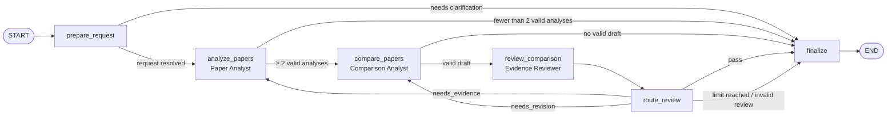

# Research Paper Comparison Assistant - Implementation Specification

| Item | Value |
| --- | --- |
| Course | COE548 Final Project: *Building a Specialized Multi-Agent LLM System Using LangChain and LangGraph* |
| Team | 4 students|
| Due | December 5, 2026 |
| Deliverables | Public GitHub repository URL, repository ZIP, PDF report (≤ 6 pages), demo video (≤ 4 minutes) |

**Conventions.** `MUST` marks required behavior. All other statements are this project's chosen design for the initial scope. Requirement IDs (`CR-xx`) trace to the project guidelines; section references such as §2.A refer to the guidelines document.

## Contents

**Part I - Requirements**
1. [Purpose and scope](#1-purpose-and-scope)
2. [Course requirements traceability](#2-course-requirements-traceability)

**Part II - Design**

3. [Architecture overview](#3-architecture-overview)
4. [Runtime and configuration](#4-runtime-and-configuration)
5. [Execution budgets](#5-execution-budgets)
6. [Document ingestion and RAG](#6-document-ingestion-and-rag)
7. [Data contracts](#7-data-contracts)
8. [Tools](#8-tools)
9. [Agents](#9-agents)
10. [Graph nodes and routing](#10-graph-nodes-and-routing)
11. [Checkpointing and follow-up requests](#11-checkpointing-and-follow-up-requests)
12. [Evidence validation and report release](#12-evidence-validation-and-report-release)
13. [Message inspection, error handling, and safeguards](#13-message-inspection-error-handling-and-safeguards)
14. [User interface](#14-user-interface)

**Part III - Delivery**

15. [Implementation plan](#15-implementation-plan)
16. [Testing and evaluation](#16-testing-and-evaluation)
17. [Submission and demonstration](#17-submission-and-demonstration)
18. [References](#18-references)

---

# Part I - Requirements

## 1. Purpose and scope

### 1.1 Objective

Build an application that compares uploaded research papers in response to a research question. It MUST explain each paper individually, compare their methods and experiments, and attach inspectable source evidence to every factual claim.

### 1.2 Why multiple agents

The task has three responsibilities that need different inputs, tools, and failure modes. Separating them into agents is a design requirement, not a decoration (guidelines §1):

| Responsibility | Why it is a separate agent |
| --- | --- |
| Per-paper analysis | Works on one paper at a time with deep retrieval; must not mix papers. |
| Cross-paper comparison | Needs every analysis at once plus a deterministic experiment-condition check that the analyst does not have. |
| Evidence review | Must judge claims independently of the agent that wrote them and can send work back for repair. |

### 1.3 In scope

- Two to five English, text-based research PDFs from a related research area.
- Comparison dimensions: research problem, methodology, experimental setup, reported findings, author-reported limitations, and experimental comparability.
- Follow-up questions within the same paper collection and conversation thread.
- Output: individual-paper analysis, comparison matrix, explained comparison, unresolved issues, and evidence references.
- A simple local interface and a downloadable Markdown report.

### 1.4 Out of scope

- Automatic paper discovery, autonomous web research, and publication-status verification.
- OCR and fine-tuning.
- Reliable extraction of figures, equations, or complex tables. When extraction loses necessary information, record the limitation and omit the unsupported conclusion.

## 2. Course requirements traceability

| ID | Guideline | Required implementation | Evidence of completion | Spec section |
| --- | --- | --- | --- | --- |
| CR-01 | §2.A | ≥ 3 distinct LLM agent roles coordinated through shared state in a LangGraph workflow with multiple nodes and edges. | Analyst, Comparator, and Reviewer execute with separate prompts and responsibilities. | 9, 10 |
| CR-02 | §2.A | ≥ 1 meaningful conditional edge. | Review results route to additional analysis, comparison revision, or finalization; stage gates route missing records to finalization. | 10.2, 10.3 |
| CR-03 | §2.B | ≥ 3 tools: vectorized RAG (embeddings + vector DB) and two more, ≥ 1 of them custom. | T1 (RAG), T2 and T3 (both custom). | 8 |
| CR-04 | §2.B | ≥ 2 agents with different (non-identical) toolsets. | Assignments in Section 9.1, enforced by the dispatcher. | 8, 9.1 |
| CR-05 | §2.C | Graph state inherits from Pydantic `BaseModel`, with mixed field types, `Optional` fields, and partial updates. | `ComparisonState` in Section 7.3; state changes logged per node. | 7.3, 10.1 |
| CR-06 | §2.C | In-memory checkpointing with `MemorySaver`. | Same-thread follow-up retains paper selection and conversation context. | 11 |
| CR-07 | §2.D | ≥ 1 agent uses Pydantic structured output with parsing/validation. | Analyst returns a validated `PaperAnalysis`; comparison and review are also structured. | 9.3 |
| CR-08 | §2.E | Print actual message types and tool calls during execution. | `SystemMessage`, `HumanMessage`, `AIMessage` (plain and tool-requesting), and `ToolMessage` printed with tool-call data. | 13.1 |
| CR-09 | §2.F | Prompting strategy, conversation management, error handling, responsible-AI safeguards. | Role prompts, bounded history, structured errors, injection and scope safeguards. | 9.2, 11, 13 |
| CR-10 | §3, §5 | Reproducible submission by a team of 3–4. | Public repository, ZIP, report, demo; no credentials committed; paid APIs and reused code identified. | 17 |

The interface is not graded on visual quality (guidelines §2.G); Streamlit is this project's choice, not a requirement.

---

# Part II - Design

## 3. Architecture overview

### 3.1 Workflow

Only the three agent nodes call the LLM. `prepare_request`, `route_review`, `finalize`, and the three stage gates are deterministic Python.

### 3.2 Components

| Layer | Responsibility |
| --- | --- |
| Interface (`app.py`) | Upload, selection, question entry, progress, report, evidence, developer view. Thin layer: no agent logic. |
| Ingestion and storage | PDF validation, page text storage, chunking, Chroma indexing. |
| Tools | T1–T3 behind a dispatcher that enforces permissions, scope, and budgets. |
| Agents | Shared bounded tool-calling loop with three role-specific prompts and output schemas. |
| Graph | `StateGraph(ComparisonState)`, conditional routing, `MemorySaver` checkpointer. |
| Reporting and logging | Release filtering, citation rendering, Markdown export, message inspection. |

## 4. Runtime and configuration

### 4.1 Technology stack

| Component | Choice |
| --- | --- |
| Language | Python 3.12 (tested with 3.12.16), locked in `uv.lock`. |
| Orchestration | LangChain for model, tool, and message interfaces; LangGraph `StateGraph` for the workflow. |
| Validation | Pydantic models for state, tool arguments, and agent outputs. |
| PDF extraction | PyMuPDF with page-level text storage. |
| Retrieval | Chroma persistent collection with one configured embedding model. |
| Chat model | One configurable API model supporting tool calling and structured output (e.g. Google Gemini or OpenAI). All three agents may share it. |
| Interface | Streamlit. |
| Storage | Local PDF/page files, Chroma data, and exported reports on disk. Checkpoints stay in process memory. |

No model training or GPU is required when hosted chat and embedding APIs are used.

### 4.2 Dependencies and credentials

- Use one locked, tested dependency set (LangChain, LangGraph, provider package, Pydantic, Chroma, PyMuPDF, Streamlit). Pin exact versions after a successful model/tool/schema smoke test. Do not mix import styles from different LangChain/LangGraph major versions without a compatibility check.
- Check model availability and accepted parameters (tool calling, structured output, retry settings) during the smoke test.
- Store model IDs and provider configuration in environment variables. Commit `.env.example`, never credentials.

### 4.3 Settings

Required environment settings: `LLM_PROVIDER`, `LLM_MODEL`, `EMBEDDING_MODEL`, the provider's credential variable(s), and `DATA_DIR`.

Configurable limits (starting values, not measured quality guarantees):

| Setting | Default | Meaning | Valid range |
| --- | --- | --- | --- |
| `MAX_PAPERS` | 5 | Maximum selected papers per comparison. | ≥ 2 |
| `MAX_FILE_MB` | 20 | Maximum size of one upload. | > 0 |
| `MAX_PAGES` | 60 | Maximum pages per paper. | > 0 |
| `CHUNK_CHARS` | 1800 | Page-local chunk length; tune with retrieval checks. | > 0 |
| `CHUNK_OVERLAP` | 250 | Overlap between adjacent chunks on the same page. | 0 ≤ value < `CHUNK_CHARS` |
| `RETRIEVAL_K` | 4 | Passages requested per paper-specific search; fewer are returned when fewer chunks match. | 1–8 |
| `MAX_REVISIONS` | 2 | Review-triggered repair cycles after the initial pass. | ≥ 0 |
| `MAX_TOOL_ROUNDS` | 3 | Tool-call rounds per agent execution. | ≥ 1 |
| `MAX_LLM_CALLS` | 40 | Global model-call budget per question, including repairs, retries, and structured-output calls. | ≥ 1 |

Selection validation: `2 ≤ selected papers ≤ MAX_PAPERS`, distinct ready paper IDs, and one common active collection. With defaults, selecting a sixth paper is rejected.

## 5. Execution budgets

### 5.1 Definitions

- `RETRIEVAL_K = 4` applies to **one filtered query against one paper**. It is neither four passages for the whole comparison nor four LLM calls.
- A **tool-call round** is one model response plus execution of all tool calls it requested. Several tool calls in one response share one round; each following model invocation is another LLM call.
- `MAX_REVISIONS = 2` means at most **three review passes** including the initial one.
- `MAX_LLM_CALLS` takes precedence over `MAX_REVISIONS`. Reaching either limit ends further repair, so exhausting 40 calls may prevent using both revisions.

### 5.2 Worst-case arithmetic

At five papers, one full pass has seven agent executions (5 Analyst + 1 Comparator + 1 Reviewer). A worst-case execution uses 3 tool-requesting invocations and 1 structured-output invocation = 4 calls, because reaching `MAX_TOOL_ROUNDS` goes directly to structured output. One full pass costs `7 × 4 = 28` calls before retries, leaving 12 of the 40 calls for retries and repairs. Three full passes would cost 84. The defaults therefore MUST NOT be documented as guaranteeing two full re-analyses; repairs are expected to be targeted (Section 5.4).

### 5.3 Call-budget manager

- One shared manager counts every provider request. Increment **before** each request, including failed attempts, structured-output calls, and formatting retries.
- Disable SDK automatic retries, or instrument them so they are counted.
- Track embedding requests and deterministic tool executions separately from `llm_calls`.

### 5.4 Reservation and admission rule

- Before any additional evidence-gathering call, reserve the minimum calls the remaining stages need: **3 calls per pending agent execution** (one tool-request invocation, one completion, one structured-output invocation).
  - First pass: reserve for the remaining papers, comparison, and review.
  - Evidence repair: reserve for the targeted papers, comparison, and review.
  - Comparison-only repair: reserve for comparison and review.
- Extra rounds and retries may use only unreserved budget. This is an admission rule, not a success guarantee.
- Repair only affected paper records; reuse unaffected validated records within the same question.
- Start a repair route only if its minimum reservation fits and `revision_count < MAX_REVISIONS`. Otherwise finalize from `last_reviewed_snapshot` as `partial`, or as `failed` if it holds no accepted claims (Section 10.4).

### 5.5 Context-window control

Before each model call, check the model's input/output context allowance. Pass relevant claims and evidence excerpts, not five full papers or the full evidence registry. Returned chunks can still be irrelevant or too large; deduplicate and select context without dropping source IDs, and report unresolved coverage.

## 6. Document ingestion and RAG

Ingestion is implemented before the agent workflow.

### 6.1 Ingestion pipeline

1. **Validate** file size, PDF readability, page count, and extractable text. Reject encrypted or unreadable PDFs and scans that need OCR, with an actionable message.
2. **Identify** each paper by `paper_id = SHA256(original_pdf_bytes)`; deduplicate repeat uploads by this ID. Generate storage paths internally, never from the uploaded filename.
3. **Extract** each page independently. Keep the original extracted text and a normalized searchable copy. Inspect the demo PDFs for column-order and table-extraction problems.
4. **Number** PDF pages from 1. Store printed page labels separately when available; never confuse them with PDF page numbers.
5. **Chunk** normalized page text into overlapping chunks that never cross page boundaries. Attach `collection_id`, `paper_id`, `pdf_page`, `chunk_id`, and text offsets. Derive `chunk_id` deterministically from collection, paper, page, and offset so re-indexing is idempotent.
6. **Index** chunks into Chroma. Store the embedding model ID and ingestion configuration with the collection; re-index into a compatible collection when the embedding model changes.
7. **Mark ready** only after pages and chunks are available. Clean up incomplete indexing attempts before retrying.

### 6.2 Retrieval rules

- For every analysis dimension, search **each selected paper independently**. A global top-k search MUST NOT substitute for per-paper coverage.
- Apply collection and paper filters in code (Chroma metadata filters), not only in prompts.
- Reuse initialized embedding and vector clients; do not construct them per tool call.
- Retrieval scores are relevance signals, not probabilities of factual correctness.

### 6.3 What goes where

The document store holds only document text and metadata. Graph state never holds vector clients, model objects, file handles, or PDF binaries.

## 7. Data contracts

### 7.1 Modeling rules

- Every record is a Pydantic model. Use `Field(default_factory=...)` for mutable defaults and validate identifiers, enums, and ranges.
- Claim and experiment IDs are assigned by code and scoped by run and paper to prevent collisions.
- Evidence IDs and source metadata are assigned by code, never by the model.
- The model fills only the LLM-facing draft schemas in Section 7.2. Code validates each draft and assembles the stored record.

### 7.2 Records

| Record | Fields | Semantics |
| --- | --- | --- |
| `Paper` | `paper_id: str`, `collection_id: str`, `filename: str`, `title: str \| None`, `page_count: int`, `ingestion_status: str` | File paths are application-managed. |
| `Evidence` | `evidence_id: str`, `paper_id: str`, `pdf_page: int`, `chunk_id: str \| None`, `text: str`, `source_kind: Literal['chunk','page']` | Created only by T1/T2. |
| `Claim` | `claim_id: str`, `dimension: str`, `text: str`, `paper_ids: list[str]`, `evidence_ids: list[str]`, `kind: Literal['reported','interpretation']` | `paper_ids` lists every paper the claim is about. An interpretation cites its factual premises and is labeled as such in output. |
| `Experiment` | `experiment_id: str`, `paper_id: str`, `model`, `dataset`, `split`, `metric`, `unit`, `baseline`, `evaluation_setting`, `hardware`, `result_text` (all `str \| None`), `evidence_ids: list[str]` | One record = one experimental context, not all results of a paper. |
| `PaperAnalysis` | `paper_id: str`, `claims: list[Claim]`, `experiments: list[Experiment]`, `missing_dimensions: list[str]`, `extraction_warnings: list[str]` | Method claims explain the mechanism and major steps. |
| `FieldComparison` | `left: str \| None`, `right: str \| None`, `result: Literal['match','different','unknown']` | Preserves both underlying values for one compared field. |
| `ConditionCheck` | `check_id: str`, `left_experiment_id: str`, `right_experiment_id: str`, `field_results: dict[str, FieldComparison]`, `status: Literal['mismatch','insufficient_information','no_mismatch_detected']` | Produced only by T3. |
| `ComparisonRow` | `dimension: str`, `claims_by_paper: dict[str, list[str]]` | Cells reference claim IDs instead of duplicating prose. |
| `Comparison` | `question: str`, `paper_ids: list[str]`, `claims: list[Claim]`, `matrix: list[ComparisonRow]`, `condition_check_ids: list[str]`, `unresolved: list[str]` | See rules below. |
| `ReviewIssue` | `claim_id: str \| None`, `paper_id: str \| None`, `category: str`, `severity: Literal['blocking','warning']`, `explanation: str`, `requested_action: str` | One targeted repair request. |
| `ReviewResult` | `verdict: Literal['pass','needs_evidence','needs_revision']`, `issues: list[ReviewIssue]`, `accepted_claim_ids: list[str]`, `checked_claim_ids: list[str]` | Every released claim must appear in `accepted_claim_ids`. |
| `ReviewedSnapshot` | `draft: Comparison`, `review: ReviewResult`, `analyses: dict[str, PaperAnalysis]`, `condition_checks: dict[str, ConditionCheck]`, `evidence: dict[str, Evidence]` | A consistent pairing of one draft with the review of that exact draft, plus the analyses, checks, and evidence it references. The only source for report rendering. |

LLM-facing draft schemas (passed to `with_structured_output`):

| Schema | Fields | Assembled by code into |
| --- | --- | --- |
| `ClaimDraft` | `local_ref: str`, `dimension: str`, `text: str`, `evidence_ids: list[str]`, `kind: Literal['reported','interpretation']` | `Claim` with a generated `claim_id` and `paper_ids` set to the analysis's paper. |
| `ExperimentDraft` | The `Experiment` fields except `experiment_id` and `paper_id` | `Experiment` with generated IDs. |
| `PaperAnalysisDraft` | `claims: list[ClaimDraft]`, `experiments: list[ExperimentDraft]`, `missing_dimensions: list[str]`, `extraction_warnings: list[str]` | `PaperAnalysis` for the paper assigned by the node. |
| `CrossPaperClaimDraft` | `ClaimDraft` fields plus `paper_ids: list[str]` | Cross-paper `Claim` with a generated `claim_id`. |
| `MatrixCellDraft` | `paper_id: str`, `claim_refs: list[str]` | One `claims_by_paper` entry. Each ref is an existing claim ID or a new claim's `local_ref`. |
| `MatrixRowDraft` | `dimension: str`, `cells: list[MatrixCellDraft]` | `ComparisonRow`. |
| `ComparisonDraft` | `selected_claim_ids: list[str]`, `new_claims: list[CrossPaperClaimDraft]`, `matrix: list[MatrixRowDraft]`, `unresolved: list[str]` | `Comparison`. Code copies selected claims unchanged, adds new claims, resolves refs, and fills `question`, `paper_ids`, and `condition_check_ids` from state and this execution's T3 results. |

`local_ref` is unique only within one draft and is never stored or displayed. LLM-facing schemas use lists instead of `dict` fields unless the provider smoke test confirms the `dict` form works.

Analysis rules:

- Every claim and experiment in a `PaperAnalysis` references only evidence whose `paper_id` equals the analysis's `paper_id`.
- An individual-paper claim has exactly one entry in `paper_ids`, equal to its analysis's `paper_id`.
- `missing_dimensions` records an absence of retrieved support, not a negative finding.

Comparison rules:

- `Comparison.claims` MUST contain every individual-paper claim selected for release (keeping its original ID) plus all cross-paper claims. Code builds this list from `ComparisonDraft`; the model never re-emits existing claims. Matrix cells reference only this list.
- A cross-paper claim has at least two `paper_ids` and MUST cite evidence from every paper in that list.
- A matrix cell `claims_by_paper[p]` references only claims whose `paper_ids` include `p`.

Review consistency rules (enforced in code; the verdict alone is never trusted):

- `accepted_claim_ids ⊆ checked_claim_ids ⊆ {claim IDs in the reviewed draft}`.
- A `pass` has no `blocking` issues, and `checked_claim_ids` and `accepted_claim_ids` both equal the full set of draft claim IDs.
- A claim is released only if it is in `accepted_claim_ids`.

### 7.3 Shared graph state

`ComparisonState` MUST inherit from `BaseModel`.

| Field | Type / default | Purpose |
| --- | --- | --- |
| `thread_id`, `run_id`, `collection_id`, `question` | `str` | Identify and scope the current request. |
| `selected_paper_ids` | `list[str]`, empty | Restrict analysis and retrieval. |
| `dimensions` | `list[str]`, empty | Validated comparison dimensions. |
| `conversation` | `list[AnyMessage]`, empty | User questions, released assistant answers, and clarification requests only. |
| `clarification_request` | `str \| None = None` | Question to the user when a follow-up's referent is ambiguous. |
| `analyses` | `dict[str, PaperAnalysis]`, empty | Latest analysis per paper. |
| `evidence` | `dict[str, Evidence]`, empty | Tool-returned evidence registered during this request. |
| `condition_checks` | `dict[str, ConditionCheck]`, empty | Authoritative T3 results. |
| `draft` | `Comparison \| None = None` | Current candidate report. |
| `review` | `ReviewResult \| None = None` | Latest reviewer decision on the current draft. |
| `last_reviewed_snapshot` | `ReviewedSnapshot \| None = None` | Latest consistent draft–review pair; preserved while repairs run and used for every final report. |
| `unavailable_paper_ids` | `list[str]`, empty | Selected papers without a valid analysis this question. |
| `repair_targets` | `list[str]`, empty | Paper IDs to re-analyze on an evidence repair. |
| `next_action` | `Literal['analyze','compare','finalize'] \| None = None` | Written by `route_review`, read by the conditional edge. |
| `revision_count`, `llm_calls` | `int = 0` | Bound repairs and model usage. |
| `is_follow_up` | `bool = False` | Marks continued interaction. |
| `status` | `Literal['running','completed','partial','failed','needs_clarification'] = 'running'` | Explicit execution outcome. |
| `final_report` | `str \| None = None` | Released Markdown. |
| `errors` | `list[str]`, empty | Sanitized operational errors. |

State update rules:

- Nodes return **partial dictionaries** and never mutate shared state in place.
- Without reducers, a returned list or dict replaces the stored value. Nodes that extend `conversation`, `analyses`, or `evidence` return the full updated collection.
- Run paper analyses sequentially in the first version to avoid concurrent map-write conflicts.
- Validate every tool result and model output explicitly before it enters state; declaring a state model does not validate external updates.

## 8. Tools

### 8.1 Common contract

- Each tool is registered with typed (Pydantic) arguments and a meaningful description.
- A dispatcher enforces agent permissions, collection scope, and paper scope **independently of model-generated arguments**. It receives the calling agent and, for the Paper Analyst, the assigned paper ID from the node, never from the model.
- Paper scope per agent:

| Agent | Papers it may access through T1/T2 |
| --- | --- |
| Paper Analyst | Only the paper it is currently analyzing |
| Comparison Analyst | All selected papers |
| Evidence Reviewer | All selected papers |
- Every tool returns the envelope `{ok, data, error_code, message}`. Failures are returned to the agent as a matching `ToolMessage`, not raised.
- Upload, chunking, and Markdown export are ordinary application functions, not tools or agents.

### 8.2 T1 - `search_papers` (vectorized RAG)

| Aspect | Contract |
| --- | --- |
| Input | `paper_id: str`, `query: str`, `k: int = RETRIEVAL_K` (1–8, default 4). |
| Scope | Active collection injected server-side; a paper outside the calling agent's paper scope (Section 8.1) is rejected. |
| Behavior | Embed the query, run a filtered vector search, register returned passages as evidence. |
| Output | `passages: list[Evidence]`, retrieval distances, `empty: bool`. |
| Notes | An empty result is valid and does not prove the paper omits the information. |

### 8.3 T2 - `read_source_page` (custom, deterministic)

| Aspect | Contract |
| --- | --- |
| Input | `paper_id: str`, `pdf_page: int` (1-based, within page count). |
| Scope | Same per-agent paper scope as T1 (Section 8.1). |
| Behavior | Read stored extracted page text and register it as evidence. Never open a model-supplied filesystem path. |
| Output | `page: Evidence` plus any extraction warning. |
| Purpose | Inspect surrounding context when a chunk is insufficient. Returns extracted text, not an interpretation of the page image. |

### 8.4 T3 - `check_experiment_conditions` (custom, deterministic)

| Aspect | Contract |
| --- | --- |
| Input | `left_experiment_id: str`, `right_experiment_id: str`. No experimental values are accepted in arguments. |
| Behavior | Load the current validated `Experiment` records from application context and compare model, dataset, split, metric, unit, baseline, evaluation setting, and hardware. Normalize whitespace/case and an explicit alias map only; never guess semantic equivalence. |
| Output | One `ConditionCheck` with both values and `match` / `different` / `unknown` per field. |
| Status precedence | Any `different` → `mismatch`; else any `unknown` → `insufficient_information`; else `no_mismatch_detected`. |
| Notes | Matching recorded fields do not prove scientific equivalence; the tool flags conditions that need explanation. |

T1 and T2 MUST preserve source provenance.

## 9. Agents

### 9.1 Roles and toolsets

| Agent | Node | Inputs | Allowed tools | Validated output |
| --- | --- | --- | --- | --- |
| A1 Paper Analyst | `analyze_papers` | Question, dimensions, one paper ID, relevant review issues | T1, T2 | `PaperAnalysisDraft` → `PaperAnalysis` |
| A2 Comparison Analyst | `compare_papers` | All analyses, relevant evidence, question, relevant review issues | T1, T3 | `ComparisonDraft` → `Comparison` |
| A3 Evidence Reviewer | `review_comparison` | Draft, analyses, condition checks, evidence registry | T1, T2 | `ReviewResult` |

A1 and A2 have different toolsets, satisfying CR-04; only A2 can call T3.

**A1 - Paper Analyst.** Search every required dimension. Explain methodology as an ordered mechanism (inputs, principal operations, outputs) where supported. Record each experimental context separately and keep units and baselines with results. Separate author-reported limitations from assistant interpretations. Never treat a failed retrieval as confirmed absence.

**A2 - Comparison Analyst.** Build paper-specific matrix entries and cross-paper explanations relevant to the question. Call T3 before interpreting any pair of quantitative results; if no meaningful pair exists, say so instead of fabricating one. Distinguish agreement, methodological difference, and evaluation mismatch. Never rank methods by incompatible numbers.

**A3 - Evidence Reviewer.** Check every candidate claim for source support, attribution, numerical context, and stated uncertainty. A cited passage can exist without supporting the claim; judge its meaning. Verify cross-paper claims against all involved papers. Return targeted repairs and accepted claim IDs. Verdicts: `needs_evidence` for missing or insufficient support; `needs_revision` for a misleading interpretation or comparison built on existing evidence; `pass` otherwise.

### 9.2 Prompting rules

- Each agent has its own `SystemMessage` defining role, permitted tools, output schema, evidence rules, and stopping conditions. Instructions go in the system message, not in an initial `HumanMessage`.
- Uploaded documents and tool results are untrusted reference content. Instructions found inside them cannot change permissions or workflow rules.
- Task messages contain only the state and evidence the agent needs (Section 5.5).

### 9.3 Execution loop and structured output

Each agent node runs one shared bounded loop:

1. Build the role's `SystemMessage` and task messages.
2. Invoke the model with that agent's tools bound.
3. Keep the returned `AIMessage`. If `AIMessage.tool_calls` is non-empty, validate and execute **every** allowed call, append one `ToolMessage` per call with the matching `tool_call_id`, and invoke again. Never infer a tool request from empty content or inspect only the first call.
4. Stop when the model finishes or `MAX_TOOL_ROUNDS` is reached. After the last allowed round, skip the extra completion call. Then obtain the role's Pydantic result via `with_structured_output(schema)`, using the draft schema for A1 and A2 and `ReviewResult` for A3. Use a separate structured-output call if the provider cannot combine tools and structured output. Code assembles A1 and A2 drafts into stored records (Section 7.2).
5. Validate schema, source IDs, paper scope, referenced record IDs, and the analysis, comparison, and review rules in Section 7.2 before updating state. Violations count as invalid output and are fed back in the one retry. The structured-output call MUST NOT introduce evidence the tools did not return.

If the output is still invalid after the retry, the record does not enter state and the node records the failure as described in Section 10.4.

Rules:

- Structured output belongs to the same agent role; it is not a fourth agent.
- Retry invalid structured output once, with validation feedback, only if the budget permits (Section 5.4). All calls count.
- Keep raw model messages for inspection.
- Never fabricate `AIMessage` tool calls to make deterministic preprocessing look agentic.

## 10. Graph nodes and routing

### 10.1 Nodes

`START → prepare_request → [gate] → analyze_papers → [gate] → compare_papers → [gate] → review_comparison → route_review → (conditional edge)`.

| Node | Type | Reads | Partial updates |
| --- | --- | --- | --- |
| `prepare_request` | Python | New user message; checkpointed selection and conversation | New `run_id`, resolved question and selection, `clarification_request`, appended conversation, `is_follow_up`, and the full per-question reset in Section 11 |
| `analyze_papers` | Agent A1 | Selected papers, dimensions, question, review issues, `repair_targets` | `analyses`, `evidence`, `condition_checks`, `unavailable_paper_ids`, `llm_calls`, `errors`. On evidence repair, only papers in `repair_targets`; checks that reference an experiment of a successfully replaced analysis are removed. |
| `compare_papers` | Agent A2 | Analyses, evidence, question, review issues | `draft` (the new valid draft, or `None` on failure), `review=None`, `condition_checks`, `evidence`, `llm_calls`, `errors` |
| `review_comparison` | Agent A3 | Draft, analyses, evidence, checks | `review`, `evidence`, `llm_calls`, `errors` |
| `route_review` | Python | Review, consistency and reference checks, revision and call limits | `next_action`, `repair_targets`, `last_reviewed_snapshot` (replaced after each consistent review that accepts at least one claim); increments `revision_count` exactly once when scheduling a repair |
| `finalize` | Python | `clarification_request`, `last_reviewed_snapshot`, `unavailable_paper_ids`, errors | `final_report`, terminal `status`, appended released or clarification `AIMessage` in `conversation` |

### 10.2 Review routing (conditional edge)

`route_review` evaluates the rules below **in order** and stops at the first match. It writes `next_action`, which the conditional edge reads. "Fallback" means: `partial` if `last_reviewed_snapshot` holds at least one accepted claim, otherwise `failed` (Section 10.4).

| # | Condition | `next_action` | Outcome |
| --- | --- | --- | --- |
| 1 | Unrecoverable failure, or `review is None` (the review was invalid after its retry) | `finalize` | Fallback |
| 2 | Verdict `pass` **and** the review consistency rules (Section 7.2) **and** the deterministic reference checks (Section 12.1) all pass | `finalize` | `completed` if `unavailable_paper_ids` is empty, otherwise `partial` |
| 3 | `revision_count >= MAX_REVISIONS`, or the minimum reservation for the needed repair route does not fit (Section 5.4) | `finalize` | Fallback |
| 4 | (Verdict `needs_evidence`, or a deterministic check found a missing or unknown evidence reference) **and** at least one repair target resolves | `analyze` | `revision_count += 1`; `repair_targets` = selected papers from each blocking issue's `paper_id` plus the `paper_ids` of its `claim_id`; → `analyze_papers` → `compare_papers` → `review_comparison` |
| 5 | Any remaining case, including `needs_revision` and an evidence issue with no resolvable target | `compare` | `revision_count += 1`; → `compare_papers` → `review_comparison` |

Both repair branches (rules 4 and 5) can be reached only after rule 3 has confirmed `revision_count < MAX_REVISIONS` and the reservation for the route that rules 4 and 5 would select fits. A `pass` that fails a consistency or reference check is not treated as passing; it falls through to rule 4 or 5.

Routing invariants:

- Each new draft invalidates the current review (`review=None`); a changed claim is never released under an earlier approval. The earlier approval survives only inside `last_reviewed_snapshot`, together with the exact draft it approved.
- An invalid claim or source reference is blocking regardless of the LLM verdict.
- A failed comparison clears `draft`, so an earlier draft can never pass `gate_after_comparison` or be reviewed again.
- A condition check never survives replacement of an experiment it references. `last_reviewed_snapshot` keeps its own copy of the checks it was reviewed with.
- Set the graph `recursion_limit` above the longest bounded route as an extra guard.

### 10.3 Stage gates

Ordinary Python conditional edges after `prepare_request`, `analyze_papers`, and `compare_papers` keep downstream agents from running on unresolved requests or missing records:

| Gate | Continue when | Otherwise |
| --- | --- | --- |
| `gate_after_prepare` | `clarification_request` is `None` | → `finalize` (`needs_clarification`, no LLM calls) |
| `gate_after_analysis` | At least two selected papers have a valid `PaperAnalysis` in `analyses` | → `finalize` (fallback) |
| `gate_after_comparison` | `draft` is a valid `Comparison` produced in this pass | → `finalize` (fallback) |

The gates only read state. Failures are recorded by the node that failed (Section 10.4).

### 10.4 Node failures and fallback

An agent node fails for a record when the record is still invalid after the one structured-output retry, when the tool loop ends without usable output, or when a provider error persists after its bounded retries.

| Node | On failure | Recorded as |
| --- | --- | --- |
| `analyze_papers`, first pass | The paper gets no analysis and is added to `unavailable_paper_ids`. The remaining papers continue. | Sanitized entry in `errors` naming the paper and failure type |
| `analyze_papers`, evidence repair | The paper's previous validated analysis is kept unchanged; the unresolved issue stays open for the reviewer. | `errors` entry |
| `compare_papers` | The node returns `draft=None`, including during a repair. | `errors` entry |
| `review_comparison` | `review` stays `None`. | `errors` entry |

When `clarification_request` is set, `finalize` returns it with status `needs_clarification` and no claims. Otherwise it always renders from `last_reviewed_snapshot`:

- `completed`: the snapshot's review is a consistent `pass` of the current draft and `unavailable_paper_ids` is empty.
- `partial`: the snapshot holds at least one accepted claim but does not meet `completed`. The report states which papers are unavailable and which questions or issues remain unresolved.
- `failed`: no snapshot, or the snapshot accepts no claims. The report gives an actionable explanation from `errors` and contains no claims.

## 11. Checkpointing and follow-up requests

- Compile the graph **once** with `MemorySaver` (`from langgraph.checkpoint.memory import MemorySaver`; `InMemorySaver` is the current name of the same class - confirm in the pinned version) and keep graph and checkpointer for the process lifetime. Do not rebuild them on Streamlit reruns.
- Generate a distinct `thread_id` per conversation, keep it in Streamlit session state, and pass it in the graph config on every invocation.
- Same-thread follow-ups keep paper selection and conversation. `prepare_request` resolves elliptical questions with deterministic rules against recent user questions, released answers, and selected paper titles.
- When a reference does not identify exactly one referent, `prepare_request` sets `clarification_request`, and the graph goes to `finalize` without calling an agent. The next message in that thread is treated as the answer, combined with the stored `question`, and `clarification_request` is cleared.
- For each newly resolved question, `prepare_request` resets every per-question field so no checkpointed result or repair instruction carries over (table below).

| Reset to | Fields |
| --- | --- |
| Empty | `analyses`, `evidence`, `condition_checks`, `repair_targets`, `unavailable_paper_ids`, `errors` |
| `None` | `draft`, `review`, `last_reviewed_snapshot`, `next_action`, `final_report`, and `clarification_request` unless this request sets a new one |
| `0` | `revision_count`, `llm_calls` |
| `'running'` | `status` |

Kept across questions: `thread_id`, `collection_id`, `selected_paper_ids`, `dimensions` (unless the user changes them), and `conversation`. The selected papers are re-analyzed for the new question; old claims are never presented as newly verified.

- Agent system prompts and tool histories stay separate from the user conversation. Bound model context to recent turns plus explicit current records; never replay the full execution log.
- Demonstrate both same-thread continuity and thread isolation.
- `MemorySaver` checkpoints are lost on restart; PDFs and Chroma data on disk persist independently.

## 12. Evidence validation and report release

### 12.1 Deterministic checks

Code MUST verify that each factual claim has evidence references, every reference exists, and its paper belongs to the request. Source IDs, page numbers/labels, and displayed quotations are resolved from stored evidence, never generated by the model. Structural validation does not establish semantic support; that is the reviewer's and the evaluation's job.

### 12.2 Report structure

The final Markdown is built deterministically from reviewed records, in this order:

1. Research question and selected papers.
2. Individual paper analyses, with methodology steps and experimental context.
3. Comparison matrix; every factual cell resolves to reviewed claims and citations.
4. Cross-paper explanation and experimental-condition differences.
5. Missing evidence, extraction limitations, and unresolved review issues.
6. Evidence appendix: paper names, PDF pages, evidence IDs, retrieved passages.

### 12.3 Release rules

- Render only from `last_reviewed_snapshot`, and only claims in its `accepted_claim_ids`, including in individual-paper sections. Never render raw analyst records or an unreviewed draft.
- On `partial`, omit or mark unavailable the rejected content, list `unavailable_paper_ids`, and state the unresolved question.
- No free-form final rewrite may add unreviewed factual statements.
- `completed` means the implemented checks passed, not that the content is scientifically correct.

## 13. Message inspection, error handling, and safeguards

### 13.1 Message inspection

- Print actual messages as they occur. Each event includes thread ID, run ID, agent, message class, content, tool name, arguments, tool-call ID, and result or error.
- Distinguish three AI cases: plain response, tool-requesting `AIMessage` (including ones with both text and tool calls), and `ToolMessage` results. Match each `ToolMessage.tool_call_id` to its request.
- Log graph transitions and the state fields each node changed.
- Keep credentials out of prompts and logs.

### 13.2 Error handling

| Failure | Handling |
| --- | --- |
| Invalid, encrypted, or scanned PDF; extraction failure | Reject at ingestion with an actionable message. |
| Empty search | Valid tool result; agent records missing support. |
| Unknown ID, out-of-scope paper, invalid tool arguments | Structured tool error returned as a `ToolMessage`. |
| Invalid structured output | One budgeted retry with feedback; otherwise the record does not enter state and the stage gates decide whether to continue (Sections 10.3, 10.4). |
| Timeout, rate limit, provider unavailable | At most two bounded, counted retries for transient errors. Permanent validation failures are never retried automatically. |
| Budget exhausted | Finalize as `partial` or `failed` (Section 10.2). |

Completed indexing work is preserved. A failed request stops without inventing an answer.

### 13.3 Responsible-AI safeguards

- Document content and tool output are treated as untrusted; embedded instructions are ignored (Section 9.2).
- Scope and permission checks are enforced in code, not prompts.
- Interpretations are labeled; missing evidence is reported rather than filled in.
- Only papers the team is permitted to use are uploaded; no private or sensitive data in the demo or repository.

## 14. User interface

- Upload and list papers with indexing status.
- Select two to five ready papers, enter a question, and choose dimensions.
- Show progress by agent, terminal status, the report, and expandable evidence.
- Support a same-thread follow-up and a "new conversation" action.
- Provide Markdown download and a developer view of actual messages, tool calls, state updates, and structured outputs.

---

# Part III - Delivery

## 15. Implementation plan

| Order | Module | Completion condition |
| --- | --- | --- |
| 1 | `config.py`, `models.py` | Validated settings; records and state from Section 7. |
| 2 | `ingestion.py`, `document_store.py` | Validated uploads, stable IDs, page text, extraction warnings. |
| 3 | `retrieval.py` | Reproducible indexing; filtered retrieval with correct source metadata. |
| 4 | `tools.py` | Three validated tool contracts; scope and permission checks; structured errors. |
| 5 | `agents.py`, `prompts/` | Shared bounded loop; three role-specific structured outputs; budget manager. |
| 6 | `graph.py` | Partial updates, repair routes, limits, retained checkpointer. |
| 7 | `reporting.py`, `logging_utils.py` | Release filtering, citations, Markdown export, message inspection. |
| 8 | `app.py` | Thin interface over ingestion and the compiled graph. |
| 9 | `tests/`, `evaluation/`, `README.md` | Acceptance checks, manually checked evidence examples, setup and demo instructions. |

The course examples and LangGraph documentation are general reference material; they address different problems than this project. When a specific script, notebook, or LangGraph pattern is adapted, cite it in the README and report at that point (Section 17.1). Unmodified course examples do not satisfy the requirements.

## 16. Testing and evaluation

### 16.1 Acceptance checks

| Area | Pass condition |
| --- | --- |
| Ingestion and provenance | Re-uploading a PDF does not duplicate it; known passages resolve to the correct PDF pages. |
| RAG and scope | Every selected paper is searched; requests cannot retrieve another collection's content; a Paper Analyst assigned paper A is refused when it requests paper B. |
| Agent and tool execution | All three agents execute; a recorded run contains genuine model-requested calls to all three tools with matching results. |
| Experimental comparison | Prepared field mismatches and unknown fields produce the specified statuses. |
| Structured output | Valid results parse; malformed results trigger bounded correction and never silently enter state. |
| Review branches | A supported draft finalizes; a draft with an intentionally unsupported claim triggers the correct repair path. The draft is injected via a labeled test fixture, never by falsifying a production trace. |
| Termination | Persistent review problems stop at the limit; the result excludes unapproved claims. |
| Review consistency | A stubbed `pass` with a blocking issue, an unchecked draft claim, or an accepted ID outside the draft is not finalized as `completed`. |
| Snapshot fallback | After one consistent review, a repair whose next review is invalid or runs out of budget finalizes as `partial` with the snapshot's accepted claims only. |
| Stage gates | A stubbed Analyst failure on all but one paper, or a Comparator failure, reaches `finalize` without invoking later agents. |
| Partial status | A consistent `pass` with one selected paper unavailable finalizes as `partial`, never `completed`. |
| Clarification | An ambiguous follow-up finalizes as `needs_clarification` with zero LLM calls; the next same-thread reply resumes the stored question. |
| Repair state | A Comparator failure during repair clears `draft` and skips review; replacing an analysis removes checks that reference its old experiments. |
| Repair targets | A blocking evidence issue with only a `claim_id` targets that claim's papers; one with no resolvable paper routes to comparison. |
| Draft assembly | Model-supplied drafts cannot set stored IDs, and selected claims keep their original IDs and text in `Comparison`. |
| Configuration boundaries | Five distinct ready papers accepted, six rejected; default retrieval requests four passages per paper query and returns fewer when appropriate; overlap ≥ chunk length rejected. |
| Revision and call budgets | A stubbed reviewer allows at most two repairs and three reviews; a counting model stub never exceeds 40 attempts including retries; budget exhaustion may stop before the second repair. Verified without paid API calls. |
| Checkpointing | A follow-up retains selection in one thread and starts with every field in the Section 11 reset table cleared; a second thread does not inherit its conversation. |
| Error handling | Invalid PDF, empty retrieval, unavailable provider, and invalid tool arguments produce useful bounded outcomes. |
| Scientific content | Manual checks confirm attribution, source support, preserved units/baselines, and separation of fact from interpretation. |

### 16.2 Evaluation set

A small, manually checked set: initially 8 questions over three permitted demo papers, plus one five-paper boundary/integration case. Cover methodology, experiments, limitations, cross-paper comparisons, and questions the papers do not answer. For each, store expected facts, supporting PDF pages, and acceptable missing-information behavior.

### 16.3 Metrics

Report measured values only; never claim unsupported accuracy.

| Metric | Definition |
| --- | --- |
| Retrieval hit rate | Answerable questions whose run evidence includes a manually identified supporting passage ÷ answerable questions. |
| Citation validity | Released citations resolving to the correct document and page ÷ released citations. |
| Claim support | Manually judged supported factual claims ÷ manually checked factual claims. |
| Missing-information handling | Unanswerable questions correctly identified without invented findings ÷ unanswerable questions. |
| Cost and performance | Per-request latency, LLM calls, token usage where provided, and API cost where provider pricing is recorded. Missing usage or prices are not guessed. |

## 17. Submission and demonstration

### 17.1 Repository

- Public GitHub repository plus a ZIP of it.
- Contents: source, pinned dependencies, `.env.example`, permitted demo files or reproducible data-preparation steps, test/evaluation instructions, and a `README.md` with install, credential, path configuration, and run commands sufficient to reproduce locally.
- Excluded: API keys, private papers, generated runtime stores (Chroma data, page files, reports), and sensitive logs.
- Attribution: list third-party libraries, models, and datasets, plus any course example or documented LangGraph pattern that was actually adapted (name the source and what was taken from it).

### 17.2 Report (PDF, ≤ 6 pages)

Must cover, per guidelines §3.B:

1. Project overview: application, objectives, motivation for multiple agents.
2. System architecture: LangGraph workflow diagram, agent responsibilities and interactions.
3. State design: Pydantic state, checkpointing, how state changes during execution.
4. Node descriptions: each node's function, the state it reads, and its partial updates.
5. Tools and RAG: tools, agent assignments, retrieval mechanism.
6. Structured output: Pydantic schemas and their use.
7. Conditional routing: the conditional edge and its logic.
8. Message handling: message types, tool calls, and tool results.
9. Prompting and development: prompting strategy, key development decisions and improvements.
10. Results and testing: representative cases and quantitative evaluation (Section 16).
11. Setup and reproducibility: installation, required APIs, dependencies, configuration. **Identify every paid API used.**
12. Team contributions: each member's responsibilities; all members contribute implementation code.

### 17.3 Demo (≤ 4 minutes)

Focus on the running application, not code walkthroughs. Show:

- A full comparison with multi-agent execution and coordination.
- Tool usage including RAG, with retrieved source evidence.
- Actual message types and tool-call/tool-result pairs.
- State updates and a same-thread follow-up (checkpointing).
- Structured output.
- Both the normal route and a repair route. Use permitted papers and clearly label any prepared fault-injection fixture.

## 18. References

- Project guidelines: supplied `Project Guidelines.pdf` (COE548 Final Project).
- LangGraph state, partial updates, and routing: <https://docs.langchain.com/oss/python/langgraph/graph-api>
- Checkpointing and in-memory lifetime: <https://docs.langchain.com/oss/python/langgraph/persistence>
- Structured output: <https://docs.langchain.com/oss/python/langchain/structured-output>
- Message objects and tool results: <https://docs.langchain.com/oss/python/langchain/messages>
- Chroma metadata filtering: <https://docs.trychroma.com/docs/querying-collections/metadata-filtering>
- PyMuPDF text extraction and reading order: <https://pymupdf.readthedocs.io/en/latest/recipes-text.html>
